# 基于 MaxKB 的电商售后智能客服

这是一个面向课程设计的智能客服项目。系统使用 MaxKB 提供知识库检索、工作流编排和大模型对话能力，再通过独立的 MCP 工具服务查询订单、物流并判断退款资格。

项目刻意控制复杂度：只实现一条容易理解、容易演示、也容易答辩的核心链路。

> 用户提问 → MaxKB 判断意图 → 检索售后知识或调用业务工具 → 大模型整理答案 → 返回可追溯结果



## 为什么这样设计

- **政策类问题走 RAG**：退换货规则、运费说明等内容来自知识库，修改文档即可更新回答。
- **实时信息走 MCP 工具**：订单状态、物流轨迹和退款资格不能让大模型猜，由 Python 业务代码计算。
- **大模型只负责理解和表达**：关键业务规则写在确定性的代码中，方便测试，也方便解释。
- **演示默认只读**：系统只查询和评估，不直接执行退款，避免误操作。

## 核心功能

1. 售后政策知识库问答。
2. 订单状态查询。
3. 物流信息查询。
4. 七天无理由退款资格评估。
5. 订单号与手机号后四位联合校验。
6. MCP Streamable HTTP 接入 MaxKB。

## 技术栈

- MaxKB v2：智能体编排、RAG、对话界面
- Python 3.10+：业务工具服务
- MCP Python SDK 2.x：标准工具协议
- Docker Compose：一键启动 MaxKB 与工具服务
- `unittest`：核心业务规则测试

## 仓库结构

```text
maxkb-smart-service/
├─ config/             # MaxKB 提示词与接入配置
├─ data/               # 可公开的模拟订单数据
├─ diagrams/           # 架构图源文件
├─ docs/               # 架构、部署与答辩文档
├─ knowledge_base/     # 导入 MaxKB 的售后知识文档
├─ start-demo.cmd      # Windows 一键启动课设演示
├─ src/smart_service/  # MCP 工具服务与业务逻辑
└─ tests/              # 自动化测试
```

## 实现进度

- [x] 明确项目边界与总体架构
- [x] 实现订单、物流、退款资格工具
- [x] 准备售后知识库与系统提示词
- [x] 增加业务规则评测与持续集成
- [x] 完成 Docker Compose 部署
- [x] 完成 MaxKB 端到端评测与答辩材料

## 一键启动演示

Windows 上双击项目根目录的 `start-demo.cmd`。脚本会自动启动 Docker Desktop、`maxkb-course`、`maxkb-smart-tools`，等待服务就绪后打开“星云商城售后助手”。

> 脚本会在 `D:\DockerDesktop\runtime` 为 Docker 创建独立的临时运行目录，用于避免 Windows 异常关机后遗留的套接字导致 Docker Desktop 无法启动。容器数据仍保存在原有 D 盘位置。

## 本地运行核心测试

```powershell
python -m venv .venv
.\.venv\Scripts\python.exe -m pip install -e .
.\.venv\Scripts\python.exe -m unittest discover -s tests -v
```

模拟订单号和对应的演示场景见 [docs/demo-data.md](docs/demo-data.md)。

完整的 MaxKB 页面配置流程见 [docs/maxkb-setup.md](docs/maxkb-setup.md)。

运行离线业务规则评测：

```powershell
.\.venv\Scripts\python.exe scripts\evaluate_rules.py
```

## 上游说明

本仓库不是把 MaxKB 官方源码改名后重新发布。它通过官方镜像使用 MaxKB，并单独保存本课程项目编写的业务代码和资料。MaxKB 由 1Panel 团队维护，采用 GPLv3 许可证，详见 [1Panel-dev/MaxKB](https://github.com/1Panel-dev/MaxKB)。
